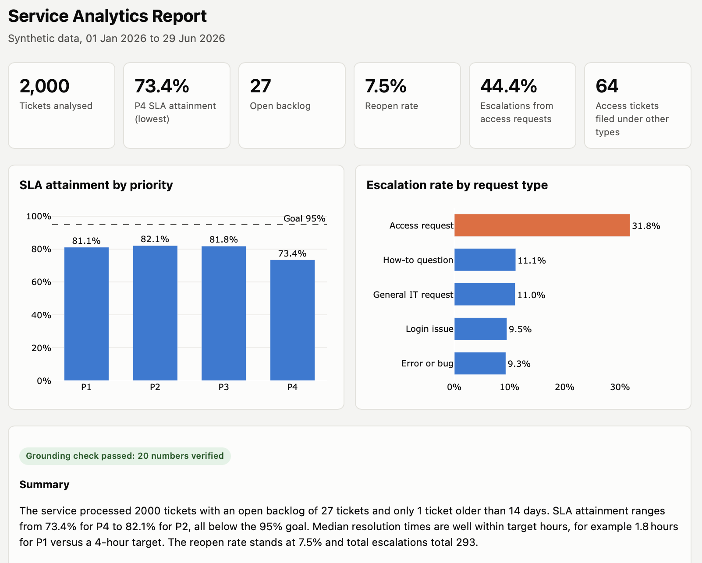

# Service Analytics Agent

An automated pipeline that turns a raw IT service desk ticket export into a one-page service review: it validates the data, computes the KPIs, uses an LLM to read the free-text descriptions, finds what drives escalations, and writes a summary in which **every number is inserted by code, not typed by the AI**.

It automates the ticket analysis I used to do by hand as an application support analyst.



---

## What it does

| Step | What happens | Output |
|---|---|---|
| 1. Generate data | Builds 2,005 realistic synthetic tickets, with known patterns and 24 deliberately planted data defects | `data/tickets.csv` |
| 2. Validate | Flags missing required fields, duplicate IDs and impossible dates | `data/data_quality_issues.csv` |
| 3. Clean | Applies documented rules: removes duplicates, excludes bad records only from the KPIs they would distort | in memory, with notes |
| 4. Compute KPIs | SLA attainment by priority, mean and median time to resolve, backlog, ticket aging, reopen rate | console and report |
| 5. Classify themes (LLM) | Sorts free-text descriptions into six defined themes, in batches, with a cache | `data/tickets_with_themes.csv` |
| 6. Escalation drivers | Pareto analysis by request type and by theme | console and report |
| 7. Grounded narrative (LLM) | Writes the summary and recommendations from a facts packet; code inserts every number and checks the draft | `data/narrative.md` |
| 8. Report | One-page HTML report with charts | `reports/service_report.html` |

## Key results (on the synthetic data)

- **SLA attainment is below the 95% goal for every priority**: P1 81.1%, P2 82.1%, P3 81.8%, P4 73.4%.
- **Access requests are 20.4% of tickets but 44.4% of escalations**, escalating at 31.8% against 10.2% for all other request types.
- **The LLM found 64 access problems filed under other request types**, mostly "not authorised" errors logged as bugs. Category-based reporting undercounts the access problem by about 15%.
- **The validator caught all 24 planted defects** (5 duplicates, 5 impossible dates, 8 missing priorities, 6 missing descriptions) with no false alarms.

## How to run it

Requires Python 3.11 or newer.

```bash
git clone https://github.com/Suhasini1011/service-analytics-agent.git
cd service-analytics-agent
python3 -m venv .venv
source .venv/bin/activate
pip install -r requirements.txt
```

**Without an API key (offline mode).** Uses the saved theme cache and the saved narrative, and still runs every check:

```bash
LLM_PROVIDER=offline python run_pipeline.py
```

**With a free API key.** Copy `.env.example` to `.env`, add a Groq key (free tier at console.groq.com), then:

```bash
python run_pipeline.py
```

Open `reports/service_report.html` in a browser.

## How it works

```
tickets.csv ──▶ validate ──▶ clean ──▶ KPIs ──────────────┐
                                  │                          ├──▶ facts.json ──▶ LLM narrative ──▶ check ──▶ HTML report
                                  └──▶ LLM themes ──▶ drivers ┘                       ▲              │
                                                                                      └── feedback ◀─┘
```

The core rule: **code does the maths, the LLM does the language.** The LLM is used only where an analyst would use judgement on text: reading messy ticket descriptions, and turning finished numbers into prose.

```
src/
  generate_data.py    synthetic tickets with planted patterns and defects
  validate.py         data quality checks
  clean.py            cleaning rules, with notes for the report
  kpis.py             KPI definitions
  llm.py              provider-agnostic LLM client (Groq or Gemini)
  categorise.py       batched, cached theme classification
  compare_themes.py   before and after comparison of prompt versions
  drivers.py          escalation Pareto analysis
  grounding.py        placeholder checks and filling
  narrative.py        facts packet and self-correcting narrative
  report.py           HTML report
templates/report.html report layout
run_pipeline.py       runs everything in order and stops on the first failure
```

## Design decisions

**Numbers are correct by construction.** The narrative prompt forbids the model from typing numbers. It writes placeholders such as `{{sla_attainment_pct_by_priority.P4}}`, and code inserts the values from `facts.json`. A checker rejects any placeholder that is not a real single fact and any number the model typed directly. If the check fails, the specific problems are sent back to the model and it rewrites the draft, up to three attempts. The report shows the result of the check, pass or fail, rather than hiding it.

**I tested the safeguards, and they needed fixing.** My first checker let the model write numbers with source citations and tried to verify each pairing. On real model output it raised false alarms, because the model grouped citations or placed them after unrelated words. After patching the parser twice, I replaced the design with placeholders, which removes the parsing problem rather than working around it. Each version has regression tests in `grounding.py`.

**LLM classification is constrained, validated and evaluated.**
- The model must choose from a fixed list of six defined themes and reply in JSON. Any missing or invented theme is replaced with "Other" in code.
- Temperature is 0 for consistency.
- I reviewed the first run against the original request types, found three ambiguous theme boundaries, and added one-line definitions to the prompt. Comparing the two versions (`theme_cache_v1.json` against `theme_cache.json`): 15 of 403 descriptions changed theme, all in the intended direction. Two misclassification patterns were eliminated and one was halved.

**Efficient on a free tier.** 2,000 tickets reduce to 403 unique descriptions, sent in batches of 25 (17 API calls). Every answer is cached and saved after each batch, so a rerun makes zero calls and an interrupted run resumes where it stopped. The cache is committed, so the project runs without a key.

**Provider-agnostic.** All LLM calls go through one function in `llm.py` using the OpenAI-compatible API format. Switching from Groq to Gemini is a change to `.env`, not to the code.

**Cleaning excludes, it does not delete.** A ticket with one bad field is excluded only from the calculations that field would distort. For example, a ticket with impossible dates still counts in volume and escalations but not in resolution time. Every adjustment is listed in the report, and every KPI reconciles back to the 2,000-ticket total.

**Analysis is tested against known answers.** The data generator plants patterns (access requests escalate at 35%, against 10% for everything else) and defects, so the analysis can be checked by whether it rediscovers them. It does: 31.8% against 10.2%, the difference from 35% being sampling variation.

## Limitations

- **Reasoning and wording are not automatically checked.** Every number is guaranteed, but the model can still frame a correct number misleadingly. In testing it described P4 (the lowest priority) as "high-priority", called a 7.5% reopen rate "frequent", and wrote "a few" tickets when there was one. The narrative is a draft for an analyst to review, not a final report.
- **The model is not perfectly consistent on borderline text.** Identical core sentences with different greetings occasionally received different themes, even at temperature 0.
- **The data is synthetic.** Escalation was generated from the request type the user picked, so misfiled access tickets escalate at the bug rate. In real data they would probably escalate more, because they reach the wrong team first.
- **Simplified SLA.** SLA targets use calendar hours, not business hours, and the targets and 95% goal are assumptions set in code.
- **Free tiers are not for real data.** Free-tier terms can allow the provider to review or reuse prompts. With real client data I would use a paid tier or an approved internal model.

## About

Built by Suhasini Pillay, drawing on three years as a business systems analyst and application support analyst owning enterprise SaaS applications for about 5,000 users. The ticket structure is modelled on a ServiceNow-style setup and fully anonymised: all people, emails and systems are fictional.

[LinkedIn](http://linkedin.com/in/suhasini-pillay-b9a644196)
